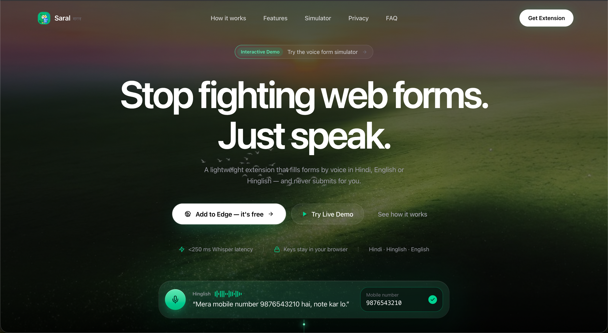

# Saral (सरल)



**Fill any web form by speaking in your language.**

Saral is a browser extension for people with limited digital literacy. Press the extension button on a web form, and Saral explains the form in Hindi, listens to you speak, fills the fields, flags anything missing or wrong, and lets you review everything before it touches the page. It never submits the form for you.

> Built for a hackathon problem statement: *AI-Powered Multilingual Voice Assistant for Digital Form Automation.*

---

## Why Saral

Online forms are hard when the form is in English, the fields are confusing, and nobody tells you what to say. People end up asking relatives or kiosk operators for help, or giving up.

Saral turns a form into a simple spoken conversation in your own language.

## Features

- **Extension** Press it on any standard web form, and the Saral side panel opens.
- **Form scanning.** Saral builds a schema from the live page: labels, types, required flags, dropdown options, and sections. No form needs to be predefined.
- **Hindi explanation.** The form's purpose, field labels, and plain-language hints are shown in Hindi, with required fields marked.
- **Voice input in Hindi and English**, including mixed Hindi-English speech, with speech-to-text from Sarvam AI.
- **Smart extraction.** An LLM (via OpenRouter) maps what you said to the right fields and normalizes values: dates, phone numbers, spoken emails ("rahul at gmail dot com").
- **Validation.** Each field is marked valid, invalid, missing, or low confidence, with a short Hindi message.
- **Review and correct.** Fix any field by voice (per-field mic) or by typing. Everything is shown before filling.
- **Guided mode.** Saral asks for one field at a time, optionally read aloud.
- **Safe filling.** Values are written into the real page and highlighted. Saral never clicks Submit.
- **Privacy-minded.** Password, card, CVV, and OTP fields are never scanned or sent anywhere. Audio is not stored.

## How it works

```mermaid
flowchart LR
    A[User presses hotkey] --> B[Content script scans form]
    B --> C[Schema JSON]
    C --> D[Side panel: Hindi explanation]
    D --> E[User speaks]
    E --> F[Sarvam STT: transcript]
    F --> G[OpenRouter LLM: field values + confidence]
    G --> H[Validator: valid / invalid / missing]
    H --> I[User reviews and fixes]
    I --> J[Fill the page, highlight fields]
    J --> K[User submits manually]
```



| Part | Role |
| --- | --- |
| Background service worker | Hotkey, message routing, calls to the AI APIs |
| Content script | Scans the form, fills fields, highlights them, skips sensitive inputs |
| Side panel (React) | Recorder, transcript, review UI, guided mode |
| Options page | API keys, language, model names |
| `chrome.storage` | Settings, translation cache, drafts |

## Tech stack

- [WXT](https://wxt.dev) (Manifest V3), React, TypeScript, Tailwind CSS
- Zustand for state, Zod for validation
- Speech-to-text: Sarvam AI
- Reasoning and extraction: OpenRouter (model is configurable)
- Tests: Vitest

## Repository structure

```
saral/
├── saral-extension/        Chrome / Edge extension (WXT + React)
│   ├── src/
│   │   ├── entrypoints/    background, content, sidepanel, options, permission
│   │   ├── components/     VoiceRecorder, FieldRow, StatusBadge, ReviewSummary, ...
│   │   ├── lib/ai/         sarvam.ts, openrouter.ts, extract.ts, translate.ts, prompts.ts
│   │   ├── lib/schema/     types, validation, normalization
│   │   ├── store/          Zustand form store
│   │   └── tests/          unit tests and HTML fixtures
│   └── public/             icons and bundled Devanagari font
├── landing/                landing page (if included)
├── docs/                   PRD, architecture, demo script
└── README.md
```

## Getting started

### Prerequisites

- Node.js 20 or newer
- Chrome or Edge
- A [Sarvam AI](https://www.sarvam.ai) API key
- An [OpenRouter](https://openrouter.ai) API key

### Install and run in development

```bash
git clone https://github.com/<your-username>/saral.git
cd saral/saral-extension
npm install
npm run dev
```

WXT opens a browser with the extension loaded and reloads it when you save a file.

### Build and load manually

```bash
npm run build
```

1. Open `chrome://extensions` (or `edge://extensions`).
2. Turn on **Developer mode**.
3. Click **Load unpacked** and select `saral-extension/.output/chrome-mv3`.

### Configure your keys

1. Open the extension's **Options** page.
2. Paste your Sarvam and OpenRouter keys.
3. Choose your default language and model.

Keys are stored in extension storage on your machine. Never commit keys: a `.env.example` is provided for reference, and real `.env` files are git-ignored.

### Use it

1. Open a web form.
2. Press the Saral hotkey (default suggestion: `Ctrl+Shift+S`; change it at `chrome://extensions/shortcuts`).
3. Read the Hindi explanation, then tap the mic and speak, or use guided mode.
4. Fix anything flagged, then tap **Fill**.
5. Check the page and submit the form yourself.

The first time you record, the browser asks for microphone permission once for the extension.

## Testing

```bash
npm test
```

Unit tests cover validation, normalization, the form scanner, the filler, audio handling, and the Sarvam client. HTML fixtures in `src/tests/fixtures/` provide sample forms, and `src/tests/fixtures/samples/` holds expected values for accuracy checks.

## Packaging for the stores

```bash
rm -rf .output
npm run zip
```

Upload only `.output/saral-extension-<version>-chrome.zip`. The same package works for the Chrome Web Store and Edge Add-ons. Do not upload the project folder, the sources ZIP, or anything from a dev build.

## Privacy

- Saral reads a page only when you trigger it on that page.
- Sensitive fields (password, card number, CVV, OTP) are skipped.
- Your speech is sent to Sarvam AI for transcription, and the transcript plus form labels are sent to OpenRouter for extraction. Check those providers' policies for how they handle data.
- Audio is not stored by Saral.
- Saral never submits a form on your behalf.

## Limitations

- Works best on standard HTML forms. Custom dropdown widgets and multi-step wizards may not scan or fill correctly.
- Chrome and Edge only (Manifest V3). Firefox and Safari are not supported yet.
- PDFs, scanned forms, and desktop apps are not supported.
- Speech recognition is imperfect for names, emails, and digits. Always review the values before filling.
- Needs an internet connection.

## Roadmap

- PDF and scanned-form support through vision models
- Multi-step wizards and custom dropdowns
- More Indian languages
- Firefox build
- Offline speech recognition

## Contributing

Issues and pull requests are welcome.

1. Fork the repo and create a branch.
2. Make your change and run `npm test`.
3. Open a pull request describing what changed and how you tested it.

## License

Add your license here (for example MIT) and a `LICENSE` file at the repo root.

## Acknowledgments

- [Sarvam AI](https://www.sarvam.ai) for Indian-language speech recognition
- [OpenRouter](https://openrouter.ai) for model access
- [WXT](https://wxt.dev) for the extension framework
- Noto Sans Devanagari (SIL Open Font License) for Hindi text

## Team

<!-- Add names and GitHub handles -->
- ZSR
